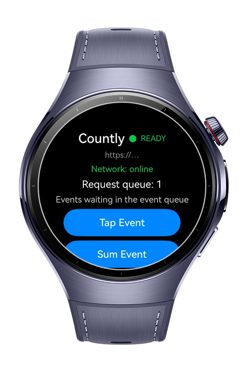

> **Note:** To access all shared projects, get information about environment setup, and view other guides, please visit [Explore-In-HMOS Index](https://github.com/Explore-In-HMOS/hmos-index).

# How to Implement Countly Analytics in HarmonyOS Wearable Apps

This HarmonyOS wearable sample shows how to integrate the official [Countly HarmonyOS SDK](https://github.com/Countly/countly-sdk-hos) (version 26.1.0) in an ArkTS watch app. The app starts the SDK in an `AbilityStage`, sets up automatic session and view tracking, and records custom events. The screen shows the SDK state, the request queue, and the SDK log.

# Preview

<div>
  
</div>

# Use Cases

- Initialize the Countly SDK in `AbilityStage.onCreate`, before any UIAbility starts
- Configure the network permissions that the SDK needs
- Use automatic session tracking and automatic view tracking
- Record simple events, events with a sum, and events with segmentation
- Send the queues on request, and keep requests in offline mode
- Show the SDK log on the watch with a log listener

# Technology

## Stack

- **Languages**: ArkTS, ArkUI
- **Frameworks**: HarmonyOS Stage Model
- **Tools**: DevEco Studio, Hvigor, ohpm
- **Libraries**:
	- `countly-sdk-hos` 26.1.0 (Countly HarmonyOS SDK, MIT License)
	- `@kit.AbilityKit` (`AbilityStage`, `UIAbility`)
	- `@kit.NetworkKit` (`connection`)

## Required Permissions

`entry/src/main/module.json5` requests the two permissions that the SDK needs:

- `ohos.permission.INTERNET`
- `ohos.permission.GET_NETWORK_INFO`

## Add the SDK

The SDK is a prebuilt `.har` file from the [GitHub release](https://github.com/Countly/countly-sdk-hos/releases/tag/26.1.0). This project contains it in `entry/libs`.

1. Put `countly-sdk-hos-26.1.0.har` in `entry/libs`.
2. Add the dependency to `entry/oh-package.json5`:
   ```json5
   "dependencies": {
     "countly-sdk-hos": "file:./libs/countly-sdk-hos-26.1.0.har"
   }
   ```
3. Run `ohpm install`, or sync the project in DevEco Studio.

> **NOTE:** When the SDK is available in ohpm, change the dependency to `"countly-sdk-hos": "^26.1.0"`.

## Initialization in AbilityStage

`AbilityStage.onCreate` runs one time for each module process, before any UIAbility. Thus, the SDK registers its lifecycle listeners before the first foreground change, and it records the first session and view of a cold start.

1. `module.json5` sets the module entry: `"srcEntry": "./ets/myabilitystage/MyAbilityStage.ets"`.
2. `MyAbilityStage.onCreate` calls `startCountly(this.context)` in `countly/CountlySetup.ets`.
3. `startCountly` reads `rawfile/countly.json`, makes the `CountlyConfig`, and calls `Countly.initShared(config)`. `onCreate` is synchronous, so the app does not wait for the promise.

`EntryAbility` has no SDK code. `Countly.initShared` is idempotent: a second call returns the same instance.

## Configuration

```typescript
const config = new CountlyConfig(context, serverUrl, appKey);
config.setAppVersion('1.0.0');
config.logging.enableLogging().setMinLevel(LogLevel.DEBUG).setListener(onSdkLog);
config.sessions.setUpdateIntervalSec(60);        // automatic sessions, update every 60 s
config.views.enableAutomaticViewTracking();      // automatic views
config.events.setQueueSizeToSend(10);            // send the event queue at 10 events
Countly.initShared(config);
```

| Feature | Function |
|---|---|
| Automatic sessions | The SDK starts a session when the app comes to the foreground, sends an update every 60 seconds, and ends the session in the background |
| Automatic views | The SDK records a view when an ability comes to the foreground |
| Event queue | The SDK sends the events when the queue has 10 events, and at its own timer |
| Log listener | Every SDK log line also goes to the on-screen log |

## Events

| Button | SDK call |
|---|---|
| Tap Event | `events.recordEvent('tap_event')` |
| Sum Event | `events.recordEvent('purchase', null, 1, 9.99)` |
| Segmented | `events.recordEvent('theme_change', { color: 'red' })` |
| Flush Now | `flushEvents()`, then `requests.flushQueues()` |

## Offline Mode

- If `serverUrl` or `appKey` in `countly.json` is empty, the app starts the SDK with `config.network.enableOfflineMode()`. The SDK records sessions, views, and events, and keeps all requests in its persistent queue. The **Request queue** counter shows the number.
- If a server is set, the **Offline mode** switch calls `requests.enableOfflineMode()` and `requests.disableOfflineMode()`. When offline mode goes off, the SDK sends the queue.

## Connect a Countly Server

1. In the Countly dashboard, open **Management** > **Applications**, and copy the app key.
2. Write the server URL and the app key in `entry/src/main/resources/rawfile/countly.json`:
   ```json
   { "serverUrl": "https://your-server.count.ly", "appKey": "YOUR_APP_KEY" }
   ```
3. Build and run the app.
4. Tap the event buttons, then tap **Flush Now**.
5. Make sure that the session, the view, and the three events show in the dashboard.

# Directory Structure

```
entry/
|   libs/
|       countly-sdk-hos-26.1.0.har
|   oh-package.json5
|   src/
|       main/
│   module.json5
│
├───ets
│   ├───common
│   │       Constants.ets
│   │       Logger.ets
│   │
│   ├───countly
│   │       CountlySetup.ets
│   │
│   ├───entryability
│   │       EntryAbility.ets
│   │
│   ├───myabilitystage
│   │       MyAbilityStage.ets
│   │
│   └───pages
│           Index.ets
│
└───resources/rawfile
        countly.json

```

# Constraints and Restrictions

## Supported Device

- Huawei Watch 5

## Notes

- The SDK is a byte-code HAR. Its source code is in the [SDK repository](https://github.com/Countly/countly-sdk-hos).

# License

**How to Implement Countly Analytics in HarmonyOS Wearable Apps** is distributed under the terms of the MIT License. See the [LICENSE](LICENSE) for more information. The Countly HarmonyOS SDK in `entry/libs` is distributed by Countly under the MIT License.
